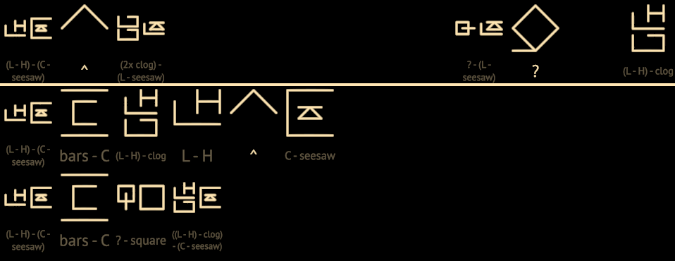
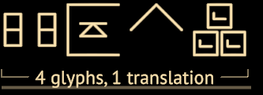
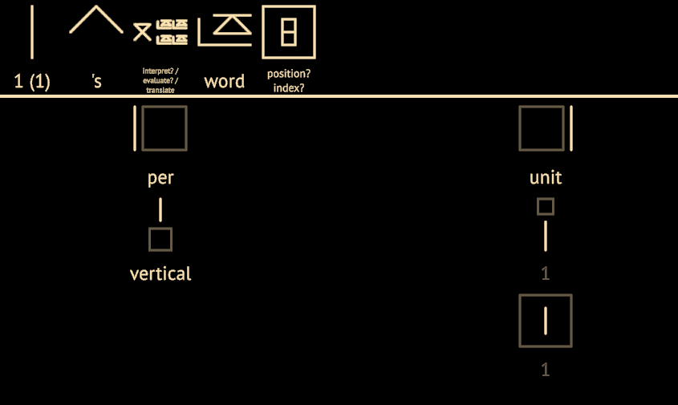

# Compound Translations

A [BepInEx 5](https://github.com/BepInEx/BepInEx) plugin for [Message From Aliens](https://store.steampowered.com/app/1858720/Message_From_Aliens/) that labels untranslated compound words with the translations of their parts, lets you translate runs of glyphs as a unit, and lets a glyph have its own translation for each position it takes in a compound.

## Installing

Install BepInEx first, if you haven't already, as described under [Requirements](#requirements). Then unzip the release zip into the game folder, the one that holds `MessageFromAliens.exe`. In Steam, right-click the game and choose Manage, then Browse local files, to open it. The zip holds `BepInEx/plugins/CompoundTranslations/`, so the mod lands in BepInEx's plugins folder. To update, unzip a newer release over it. To uninstall, delete `BepInEx/plugins/CompoundTranslations/`.

## Compound words

A word is a compound when its two components are both other words, or when it is one other word repeated two, three, or four times. When a compound has no translation, its English label changes from `?` to `<part 1> - <part 2>`, or `<n>x <part>` for a repeat (such as `3x small`). A word whose two components are the same word side by side or stacked also counts as a repeat. Each part is:

- the part's translation, if it has one;
- otherwise, if the part is itself a compound, its own hint in brackets, e.g. `[<part 1a> - <part 1b>] - <part 2>`;
- otherwise `?+` if the part has translated parts that are not shown, such as parts beyond the `Depth` limit;
- otherwise `?`.

If the word type that the compound's information panel names has a translation, the hint ends with it in parentheses, e.g. `<part 1> - <part 2> (<type>)`. A hint is shown only if at least one translated word appears in it. Otherwise the label stays `?`, or becomes `?+` if the word has translated parts at any depth. The label is drawn in the dimmed color the game uses for finished chapters (`Draw.DefaultColor(3)`).

The hint is display-only. Clicking the label to edit it starts from an empty field as usual, and the hint is never saved as a translation. Translating a word, or changing a setting at runtime, refreshes the visible hints.



Here you can see that the `L`, `seesaw`, and `| |` glyphs have been "translated" by the player. The mod is assembling those into compound translations where possible.

## Sequence translations

While editing a glyph's label, shift+click the label of another glyph in the same sentence. Both glyphs and every glyph between them are selected: their own labels are hidden, and one label centered below the run opens for editing. While it is being edited, a bracket in the label color marks the run: a line through the label on each side of the text, spanning the run, with ticks up toward the glyphs at its ends. Shift+click again to extend the selection. Shift+clicking a run's translation adds the whole run to the selection.

A run can't span an empty cell. Spaces count where the text has them, also where a line wraps: a space that falls at the end of a row shows no gap but still splits runs, and the indent at the start of a continued row is not a space. A shift+click that would select across a space selects only the clicked glyph, or the run that holds it, and a new selection starts there. Runs saved by older versions that span a space are never shown; they stay in the save.

Every occurrence of the same glyphs in the same order, anywhere in the game, shows that translation instead of the individual labels. Clicking any glyph label inside a run edits the run. While the mouse is over one of a run's glyphs, the run steps aside and the glyphs' own labels show. Clearing a run's translation removes it. Where runs overlap, the leftmost wins, then the longest. A saved run is not shown where one of its words also belongs to words outside it, across a conjunction. Two glyphs on either side of a glyph you translated as `and` or `or` are joined when they have a word type in common, and a glyph you translated as `to` joins them only between two numbers, as in "1 to 2 year". A run that starts right after such a conjunction is not used, because its later words may belong to both sides: in "up and down face", a run for "down face" is not used. A run that ends right before one is not used either, because its earlier words may: in "big dog and cat", a run for "big dog" is not used. A run that ends right before a list counts the same way: single glyphs separated by spaces, the last joined by `and` or `or`, all with a word type in common with the run's last glyph, as in "with red, green or blue". Both sides keep their own words, and the run is used, when the glyph beside the joined one in the run is a noun or adjective joined with words of its own type ("big dog and small dog"), when nouns are joined and that glyph is a noun or number, or when numbers are joined and that glyph, before them, is a noun or number. Chemical formulas and numbers' own digits are like this. A translation that lists alternatives separated by punctuation, such as `end / to` or `end, to`, counts if any of them is one of these words.

A sentence is one line of text as the game draws it in one place, which may wrap onto several rows. Lines drawn separately are separate sentences, even when they share a part of the screen. Lists of glyphs are not sentences, and their glyphs are always labeled and edited one by one: each panel's row of buttons, the minigames' rows of moves, choices, buttons, and cards and their game boards, the dictionary's row of categories and grid of a category's words, on the dictionary page and in the note editor, a quiz's row of offered glyphs, and the options after a setting's name on the game's settings page and on Mod Settings' pages. A setting's name can still be a run. A run that wraps has its bracket line on each row, with ticks only at its start and end, and its label goes under the widest row.

Run translations are saved in your save slot alongside the game's own translations, as entries whose names start with `compoundtranslations.sequence:`. The game ignores them. They stay in the save if the mod is removed.



Here you can see one translated phrase that applies to a sequence of four glyphs.

## Position translations

A glyph can have a different translation for each place it takes in a compound of two different words. A glyph's information panel, shown by right-clicking it, gets a new line above the definitions when the glyph takes a place in a compound you have encountered, underlined like a menu link, which will open the positional translation interface and indicate if it's already filled out.

The new interface allows specifying a translation for a glyph that will be used in a compound word partial translation if the sub glyph appears in a particular position. The panel shows only the positions the glyph takes in compounds you have encountered: compounds the game has drawn for you anywhere, and the compounds inside them. An empty field shows, dimmed, what hints use in its place: the glyph's translation, or, for an untranslated compound, its own hint in brackets. Tab moves through the fields along with the glyph labels. With Interface Tweaks' keyboard shortcuts on, the fields follow its Tab order, one panel at a time, and Shift+Tab goes back through them.

On a compound's information panel, the line that names its two parts labels each part with its translation for its place in that compound, when it has one, in place of its own translation. Editing that label edits the position translation. A part without one keeps its own label, and editing it edits its own translation.

Position translations are saved in your save slot alongside the game's own translations, as entries whose names start with `compoundtranslations.position:`. The game ignores them. They stay in the save if the mod is removed.

<details>
  <summary>SPOILER WARNING: Screenshot of positional translations reveals some alternate meanings of a common early game glyph</summary>
  
  
</details>

## Configuration

`BepInEx/config/sparr.messagefromaliens.compoundtranslations.cfg`, created on first launch:

| Key | Default | Effect |
|---|---|---|
| `Display.Separator` | `" - "` | Text between the two parts. |
| `Display.Brackets` | `"[]"` | Opening and closing brackets around each compound, as one string split in half, e.g. `"()"` or `"<<>>"`. `""` for none. |
| `Display.OmitOuterBrackets` | `true` | Leave out the brackets around the whole label, keeping them around nested compounds. |
| `Display.Depth` | `-1` | Layers of compounds to expand. `-1` expands all layers, `0` disables hints, `1` shows only the translations of a word's direct parts. |
| `Display.MarkHidden` | `true` | Show `?+` instead of `?` when the word has translated parts that are not shown. |
| `Display.ShowWordType` | `true` | Append the compound's word type in parentheses to a hint when the type has a translation. |
| `Sequences.Enabled` | `true` | Show and allow sequence translations. |
| `Sequences.RevealOnHover` | `true` | While the mouse is over a glyph inside a run, show the glyphs' own labels instead of the run's translation. |
| `Positions.Enabled` | `true` | Show the glyphs that open the position translations panel, and use position translations in hints. |

Each setting is tagged with its name in glyphs, and the mod names itself in glyphs, so Mod Settings can show them in the game.

BepInEx trims whitespace from setting values, so `Separator` and `Brackets` are written in double quotes, which are removed when read. Quotes are optional when the value has no leading or trailing spaces.

## Requirements

- BepInEx 5.4.23.6 or later, `BepInEx_win_x64` build, unzipped into the game folder. Tested with Unity 6000.6.8f1.
- On Linux under Proton, set the Steam launch options to `WINEDLLOVERRIDES="winhttp=n,b" %command%`.
- Optional: [Mod Settings](https://github.com/sparr/messagefromaliens-mod-ModSettings) 0.2.0 or later, to change settings in the game. Mod Settings' choice glyphs are kept from forming runs.
- Optional: [Interface Tweaks](https://github.com/sparr/messagefromaliens-mod-InterfaceTweaks) 0.3.0 or later, for its Tab order through position fields and run labels.
- .NET SDK 8 or later to build.

## Building

```sh
dotnet build -c Release
```

With `-p:DeployToGame=true`, the build also copies `CompoundTranslations.dll` to `<game>/BepInEx/plugins/CompoundTranslations/`.

The build looks for the game in `<SteamLibraryDir>/steamapps/common/Message From Aliens`. `SteamLibraryDir` comes from the first of these that is set:

1. `-p:SteamLibraryDir=/path/to/SteamLibrary` on the command line.
2. A `SteamLibraryDir` environment variable.
3. `GamePaths.props`, a copy of `GamePaths.props.example`. It is ignored by git.
4. Steam's default install location: `~/.local/share/Steam` on Linux, `C:\Program Files (x86)\Steam` on Windows.

For a game folder outside a Steam library, set `GameDir` to the game folder the same ways.

## Patches

| Method | Patch |
|---|---|
| `AlienCharacter.UpdateEarthText` | Postfix: for a word with no translation (saved value blank or `?`, ignoring surrounding spaces), unless the label is being edited or is selected, replaces the label's leading `?` with the hint, keeping any unit or number suffix the game appends, and sets the label color. Otherwise restores the normal label color. On a part glyph in a compound's composition line, shows the part's position translation when it has one. Hides the label of a glyph inside a run, keeping its text. |
| `AlienCharacter.StartEdit` | Prefix: on a glyph inside a run selected by Tab or the arrow keys, skips the game's edit, keeps the label from activating, and selects the run's label instead after the selection handling. Postfix: restores the normal label color while editing, and on a part glyph labeled with a position translation, starts the edit on that translation. |
| `AlienCharacter.LateUpdate` | Prefix: on the frame a position translation's edit starts, keeps that translation in the label, where the game would put the word's own. |
| `AlienCharacter.EndEdit` | Prefix: skips the game's end of edit, its save included, for a position translation's edit, which it saves instead. Postfix: records the glyph for extending the selection with shift+click, finds runs again, refreshes the labels of visible untranslated compounds built from the glyph's word, and redraws an open positions panel. |
| `TMP_InputField.OnPointerDown` | Prefix: on shift+click, or a click on a glyph inside a run, selects the run's label in place of the pressed label, which is then never selected or activated. |
| `Draw.Write` (list overload) | Postfix: records which call drew each glyph and that call's row layout, so lines from separate calls stay separate sentences, spaces at a wrap are counted, and lists are left out. Finds the part glyphs of a compound's composition line in the left panel. |
| `Draw.ClearSelected` | Prefix: ends the edit of a run's label as a redraw starts, so it is saved under that run. Postfix: marks the glyph layout as changed, so runs are found again after the redraw, in the same frame. |
| `Draw.Update` | Prefix: Tab from a glyph label selects the next position field when one comes before the next label, or with Interface Tweaks' order, the previous one for Shift+Tab. |
| `Draw.UpdateText1` | Prefix: rewrites the position translations button in the left panel's history, so every entry shows whether its glyph has position translations. Postfix: marks the left panel as changed, so the position translations button and panel are found and built again after the redraw, in the same frame. |
| `Draw.PushLeftText` | Prefix: adds the glyphs that open the position translations panel to a word's information text. |
| `HardwareCursor.Apply` | Prefix: gives the cursor the clickable color over the position translations button. |

Each applied hint is logged at the `Debug` level.
