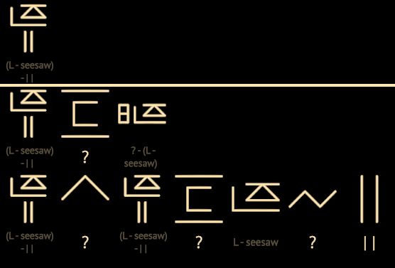

# Compound Translations

A [BepInEx 5](https://github.com/BepInEx/BepInEx) plugin for [Message From Aliens](https://store.steampowered.com/app/1858720/Message_From_Aliens/) that labels untranslated compound words with the translations of their parts.

A word is a compound when its two components are both other words. When a compound has no translation, its English label changes from `?` to `<part 1> - <part 2>`. Each part is:

- the part's translation, if it has one;
- otherwise, if the part is itself a compound, its own hint in brackets, e.g. `(<part 1a> - <part 1b>) - <part 2>`;
- otherwise `?+` if the part has translated parts that are not shown, such as parts beyond the `Depth` limit;
- otherwise `?`.

A hint is shown only if at least one translated word appears in it. Otherwise the label stays `?`, or becomes `?+` if the word has translated parts at any depth. The label is drawn in the dimmed color the game uses for finished chapters (`Draw.DefaultColor(3)`).

The hint is display-only. Clicking the label to edit it starts from an empty field as usual, and the hint is never saved as a translation. Translating a word, or changing a setting at runtime, refreshes the visible hints.

## Example



Here you can see that the `L`, `seesaw`, and `| |` glyphs have been "translated" by the player. The mod is assembling those into compound translations where possible.

## Configuration

`BepInEx/config/sparr.messagefromaliens.compoundtranslations.cfg`, created on first launch:

| Key | Default | Effect |
|---|---|---|
| `Display.Separator` | `" - "` | Text between the two parts. |
| `Display.Brackets` | `"()"` | Opening and closing brackets around each compound, as one string split in half, e.g. `"[]"` or `"<<>>"`. `""` for none. |
| `Display.OmitOuterBrackets` | `true` | Leave out the brackets around the whole label, keeping them around nested compounds. |
| `Display.Depth` | `-1` | Layers of compounds to expand. `-1` expands all layers, `0` disables hints, `1` shows only the translations of a word's direct parts. |
| `Display.MarkHidden` | `true` | Show `?+` instead of `?` when the word has translated parts that are not shown. |

BepInEx trims whitespace from setting values, so `Separator` and `Brackets` are written in double quotes, which are removed when read. Quotes are optional when the value has no leading or trailing spaces.

## Requirements

- BepInEx 5.4.23.6 or later, `BepInEx_win_x64` build, unzipped into the game folder. Tested with Unity 6000.6.8f1.
- On Linux under Proton, set the Steam launch options to `WINEDLLOVERRIDES="winhttp=n,b" %command%`.
- .NET SDK 8 or later to build.

## Building

```sh
dotnet build -c Release
```

The build copies `CompoundTranslations.dll` to `<game>/BepInEx/plugins/CompoundTranslations/`. Disable the copy with `-p:DeployToGame=false`.

The build looks for the game in `<SteamLibraryDir>/steamapps/common/Message From Aliens`. `SteamLibraryDir` comes from the first of these that is set:

1. `-p:SteamLibraryDir=/path/to/SteamLibrary` on the command line.
2. A `SteamLibraryDir` environment variable.
3. `GamePaths.props`, a copy of `GamePaths.props.example`. It is ignored by git.
4. Steam's default install location: `~/.local/share/Steam` on Linux, `C:\Program Files (x86)\Steam` on Windows.

For a game folder outside a Steam library, set `GameDir` to the game folder the same ways.

## Patches

| Method | Patch |
|---|---|
| `AlienCharacter.UpdateEarthText` | Postfix: for a word with no translation (saved value blank or exactly `?`), replaces the label's leading `?` with the hint, keeping any unit or number suffix the game appends, and sets the label color. Otherwise restores the normal label color. |
| `AlienCharacter.StartEdit` | Postfix: restores the normal label color while editing. |
| `AlienCharacter.EndEdit` | Postfix: refreshes the labels of visible untranslated compounds. |

Each applied hint is logged at the `Debug` level.
